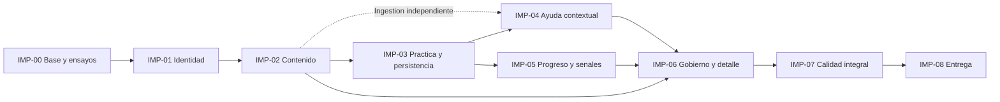

# Plan progresivo de implementación de Alunza

**Navegador y capacidad local `.13`, 17/11/2026:** incremento implementado y validado en Ryzen/Chrome: 48/48 pruebas, p95 visible RUN8 4761,700 ms/SUBMIT8 4515,800 ms; capacidad 24 ofertas/ocho admisiones/16 rechazos sin efecto durable; recuperación en ambos puntos de caída. [Registro final y limitaciones operativas](../work/IMP-03-navegador-capacidad-13.md). Se conserva una VM simultánea y los límites originales. Es evidencia local; siguen pendientes RNF remoto, CI integral y aceptación humana, sin cambiar proveedor productivo ni AD-ARQ-001.

**Recorrido HTTP local `.13`, 17/11/2026:** API/Auth/PostgreSQL reales en Ryzen aprobaron 40/40 normales (20 RUN8 y 20 SUBMIT8), con p95 HTTP de 4597,111313/4389,107517 ms. Aprobaron nueve gates funcionales, con 47 VMs nuevas, y un gate adicional de recuperación tras reiniciar la API, con una VM más. Perfil caliente, secuencial y loopback; una VM nueva por admisión efectiva, límites intactos y `local-vm` opt-in local/test. [Estado y evidencia](../work/IMP-03-api-fisica-13.md). Navegador, concurrencia y RNF remoto siguen sin aceptación; AD-ARQ-001 y el proveedor productivo no cambian.

**IMP-03.07 verificado localmente, 04/11/2026:** RUN/SUBMIT incorpora Vercel
Sandbox, contexto durable y recuperación según [registro](../work/IMP-03-sandbox.md).
Las campañas de preproducción están preparadas; integración real, aislamiento
cloud y rendimiento remoto permanecen pendientes. Producción no se activa.

**IMP-07.01 completado en su alcance, 03/11/2026:** la [auditoría de cobertura](../work/IMP-07-coverage.md)
y su [matriz](../work/IMP-07-coverage-matrix.json) consolidan los 108 escenarios,
29 RNF, seis ORG, 14 SEC y seis verticales. El registro conserva el estado de
verificación; el control offline no acepta producto ni ejecuta campañas.
Las brechas de pruebas se especifican para sus incrementos. IMP-06.04 sigue
bloqueado; IMP-03.07 se desarrolla en el corte posterior indicado arriba.

**IMP-06.07 verificado funcionalmente, 03/11/2026:** [plan autorizado](../work/IMP-06-governance-phase-plan.md), [matriz de 16 escenarios aprobados](../work/IMP-06-governance-phase-matrix.md) y [registro de ejecución](../work/IMP-06-governance-phase.md). Seis HTTP, 1.513 aserciones SQL y seis Cypress sobre el mismo candidato; ocho Cypress de regresión .06 y controles generales/focales aprobados. Inventario vigente 125/18, contextual intacto 69/10. El agregador conserva aceptación **bloqueada**, código 2: .04 sigue pendiente y no se ejecutó CI completa.

`resumption-15` catalogó cinco eventos del ETL secundario y conservó 13.676 archivos. Procedencia y mapping incompletos: **HOLD_UNRESOLVED_SECONDARY_ETL**, sin abrir el principal ni reanudar campañas; **9/17 y 0/1 CI final**. Primero falta acreditar ese origen y significado mediante evidencia independiente. Ese ciclo no inició otra fase ni acreditó aceptación humana/remota.

**Corte histórico IMP-06.06, 02/11/2026:** checkpoint `8161b3b` realizado y CSV implementado según [plan autorizado](../work/IMP-06-audit-export-plan.md). El [registro](../work/IMP-06-audit-export.md) conserva pruebas generales, 24 HTTP, 1.513 aserciones SQL, upgrade, ocho Cypress .06 y ocho de regresión .05, Excel y rendimiento aprobados. Diagnóstico offline .04 acotado terminado con procedencia del segundo ETL inconclusa; permanecen 9/17 contextuales y 0/1 CI final, sin reanudar campañas. .07 queda pendiente.

**Corte histórico IMP-06.05, 02/11/2026:** visor administrativo implementado y verificado localmente según el [plan autorizado](../work/IMP-06-audit-read-plan.md) y [registro de evidencias](../work/IMP-06-audit-read.md). Consulta, aislamiento, upgrade, ocho recorridos Cypress y rendimiento focal aprobados. El cierre detenido .04 conserva su estado; CSV .06, aceptación integrada .07 y validación humana/remota siguen pendientes.

**Actualización 01/11/2026:** IMP-06.04 está implementado y sus focos locales aprobaron,
con [plan](../work/IMP-06-signal-review-plan.md),
[contrato](../work/IMP-06-signal-review-dictionary.md) y
[registro de verificación](../work/IMP-06-signal-review.md). El cierre integral
permanece pendiente; el registro conserva fallos de CI y los estados reales de las
verificaciones adicionales, sin convertir focos separados en CI aprobada.

**Decimotercera reanudación — corte histórico del 02/11/2026 (`resumption-13`):**
el paso manual terminó: la captura secuencial
`capture-20261102T2014038955625` conservó el RAW esperado, sus **24 muestras**
aprobaron y la sesión quedó inactiva tras un solo arranque. Los controles de
captura y limpieza aprobaron.

La única invocación del lector congelado rechazó el inventario con
**`RAW_INVENTORY_MISMATCH`**, antes de crear `offline-analysis`: **cero lecturas
ETL**. Junto al RAW esperado de **48300032 bytes** existe otro ETL de
**262144 bytes**, con prefijo `WPRC_Internal_Collector_`; su origen y semántica
requieren clasificación. No se lo excluyó ni se cambió el guard para continuar.
La cobertura de las 24 consultas **no fue evaluada** y no hubo reintento.

No se solicita otra acción manual. Durante el análisis no hubo nuevo E2E,
carga o captura; ON/OFF, ABBA y CI permanecen detenidos. Siguen **9/17**
contextuales y **0/1** CI final, con código y B intactos, sensor sin calificar y
cierre local **PENDIENTE**, según el
[registro de cierre](../work/IMP-06-signal-review-closure.md).

**Duodécima reanudación — corte histórico del 02/11/2026 (`resumption-12`):**
el protocolo secuencial está **preparado y verificado, no capturado**. Mantiene
**24 lecturas a 1 Hz**, **12 trabajadores**, **64 KiB × 512 buffers** y guard
de **45 s**; fija `MaximumFileSize=256` y un tope de **268435456 bytes**.
Exige `QUERY` antes y después, modo secuencial real, cero pérdidas y ETL RAW
retenido. El lector deberá comprobar la cobertura completa de las 24 consultas.

Pruebas focales y preflight aprobaron; el paquete de **51 archivos** quedó
congelado sin iniciar captura, consultas reales ni carga. Falta la ejecución
manual elevada por privilegios de Windows; la autorización del usuario ya
existe. Se permite un solo intento y se conservan las condiciones de parada.
La brecha anterior de **1874,632 ms** permanece como evidencia rechazada,
sin atribuirla a sobrescritura circular ni reinterpretarla como aprobación.

No se calificó el sensor ni se ejecutaron nuevas ON/OFF, ABBA, campañas o CI:
**9/17** contextuales y **0/1** CI final. Código y B permanecen intactos y el
cierre local sigue **PENDIENTE**. El
[registro de cierre](../work/IMP-06-signal-review-closure.md) conserva el
protocolo, las pruebas y sus límites; esta preparación no acredita un RAW real.

**Undécima reanudación — corte histórico del 02/11/2026 (`resumption-11`):**
el usuario completó la captura manual elevada: salida cero, sesión detenida y
**24 muestras válidas**. La lectura TDH rechazó CSwitch v5 con error **1168**.
El lector offline posterior usa Microsoft TraceEvent **3.2.8**, con fuente y
DLL fijadas; aprobó **62 aserciones** de filtros/sanitización y recorrió el ETL
completo: **831451 eventos scheduler**, sin formas no soportadas. Esas pruebas
no constituyen un oráculo binario independiente del parser oficial.

**La cobertura falla:** el primer evento scheduler llega **1874,632 ms**
después del inicio acreditado y las consultas 0 y 1 quedan enteramente antes
de la evidencia scheduler. El reloj QPC coincide y la cabecera informa cero
pérdidas, pero eso no recupera el tramo ausente. No se reconstruyeron estados
ni se atribuyó una causa al sensor o a PHASE-08; tampoco quedó calificado.

Se mantiene la parada: **9/17** campañas contextuales y **0/1** CI final.
No hubo recaptura, nuevas campañas, ON/OFF, ABBA ni CI; no se solicita otra
acción manual ni se programa un reintento automático. Código y B permanecen
intactos. El cierre local sigue **PENDIENTE**, con resultados y límites en el
[registro de cierre](../work/IMP-06-signal-review-closure.md).

**Décima reanudación — corte histórico del 02/11/2026 (`resumption-10`):** la
nueva autorización amplió el máximo a **17** campañas contextuales; siguen
consumidas **9/17** y **0/1** CI final. Un diagnóstico local conservó **72 pares
válidos** (12 sin carga inducida y 60 bajo carga). En las **46 lecturas lentas**, la etapa
`nativeQuery` concentró **99,8836 %** del tiempo transcurrido del probe; el
autocoste del sensor original bajo carga fue **16,05699 %**. Esto localiza la
demora, pero no distingue Running/Ready/Waiting ni demuestra la causa de PHASE-08.
No hay nuevo candidato, calificación, ON/OFF, ABBA ni CI.

El inicio de ETW fue denegado con **`0x80070005`** y la instancia quedó inactiva.
El paquete manual privado `resumption-10/etw-run/` está preparado, con preflight
validado sin captura ni carga y una captura propuesta de **24 lecturas y 12 trabajadores**.
Su ETL real está pendiente; el contexto elevado se declara y no acredita
aceptación de PHASE ni equivalencia con ensayos anteriores. El cierre local
sigue **PENDIENTE**; el [registro de cierre](../work/IMP-06-signal-review-closure.md)
conserva los controles, la evidencia y las condiciones de parada.

**Novena reanudación — corte histórico del 02/11/2026 (`resumption-09`):** la
calificación no contextual del candidato de sensor falló. La lectura de CPU
en Windows dentro del mismo proceso no resolvió el autocoste bajo carga:
**A 28,888 % / B 28,607 %**, frente al límite del **1 %**, con CPU compartida
del host de aproximadamente **90,88 %**. Los demás controles de carga,
cobertura, reloj, integridad y limpieza fueron válidos; no se atribuye una causa
a esos tiempos. Las **693 pruebas de preproducción** y **55 aserciones nativas**
aprobadas verifican el candidato, no su calificación ni la CI final.
El candidato fue archivado y retirado, y se restauró el sensor original;
se conservan `runnerUi: false` y dos pruebas del contrato de tiempo transcurrido.
No hay una corrección de sensor aceptada ni nuevas campañas contextuales,
ON/OFF, ABBA o CI: siguen **9/16** y **0/1** CI final, con la parada vigente.
El cierre local permanece **PENDIENTE**. El
[registro de cierre](../work/IMP-06-signal-review-closure.md) conserva el rechazo,
el archivo del candidato y la procedencia de la restauración.

**Sexta reanudación — corte histórico del 01/11/2026 (Santiago):** el usuario
amplió el máximo global a **11** campañas contextuales: cinco anteriores y seis
para D_A08, D_B08 y ABBA. Se calificó la instrumentación de tablero y progreso,
con cuatro perfiles. D_A08 reprodujo PHASE-07/08 (**67 PASS/2 FAIL**); D_B08
aprobó **69/69**, los seis gates y la observación (**2253/2253** correlaciones).
La predicción registrada antes de B se cumplió: la media de inicio a efecto de
sesión de progreso concurrente bajó **86,26 %** y la unión observada de long
tasks **87,71 %**. Esta comparación instrumentada no acredita causalidad final.

El nuevo A1 sin diagnóstico terminó el `2026-11-02T02:23:44.959Z` (01/11 en
Santiago), con **68 PASS/1 FAIL/0 SKIP**: PHASE-07 tuvo p95 concurrente
**3962 ms**, pero PHASE-08 aprobó con **2828,3 ms** y no reprodujo el fallo
exigido por el control. Se rechazó A1 y se detuvo la secuencia, conservando
**27 capturas** y **792 archivos** estables. B quedó restaurado y TEST detenido.
El consumo es **8/11** contextuales y **0/1** CI final; en esta secuencia ABBA
se ejecutó **1/4**, con **0 controles conformes**. B1/B2/A2 y CI no se iniciaron;
el saldo de tres campañas no autoriza repetir tras la parada. El cierre técnico
local de .04 permanece **PENDIENTE**; no cambia la aceptación humana/remota.

**Auditoría del 02/11/2026 (`resumption-07`):** se confirmó la comparabilidad
de fuentes, métrica y oráculos lógicos; coinciden los **18 p95** recalculados
y las nueve cargas tienen intervalos físicos válidos. No se observó desaparición
del fondo. Esto no prueba neutralidad del diagnóstico ON/OFF: el flag también
afecta la compilación web y el autocoste directo no acota la perturbación indirecta.
Las **15/15 pruebas offline** califican el auditor, no la CI ni la causa de
PHASE-08. No hubo nuevas campañas: **8/11** contextuales y **0/1** CI final.
A1 sigue rechazado y la parada continúa, sin B1/B2/A2 ni CI. El
[registro de cierre](../work/IMP-06-signal-review-closure.md) conserva los límites;
el cierre local permanece pendiente.

**Octava reanudación — corte del 02/11/2026 (`resumption-08`):** la
comparación controlada ON/OFF se fijó prospectivamente en **16** contextuales:
ocho previas, cuatro de calibración y cuatro ABBA; CI final, máximo una y
condicionada a los controles. El instrumental privado aprobó **80/80 pruebas
offline**, sin equivaler a una CI del producto.
La serie se detuvo en **CAL_OFF1**: **68 PASS/1 FAIL/0 SKIP**, PHASE-07
concurrente **4150,8 ms** y PHASE-08 aprobado con **2838,3 ms**. El motivo de
rechazo de la calibración fue el autocoste del observador común de host en
tablero: **2,036 %**, superior al límite del **1 %**. Se conservaron las seis
series de 50 muestras válidas y sus primeras navegaciones, las cargas válidas
y las 27 capturas requeridas.
La comparación OFF–ON–ON–OFF quedó incompleta (**1/4**); no se iniciaron
ON1/ON2/OFF2, un nuevo ABBA ni CI. Consumo **9/16** contextuales y **0/1** CI
final. No se demuestra neutralidad ON/OFF ni causa de PHASE-08; A1 conserva su
rechazo histórico. No se añadió una corrección de código ejecutable, B quedó
restaurado y TEST detenido. La parada y el cierre local **PENDIENTE** se mantienen;
el [registro de cierre](../work/IMP-06-signal-review-closure.md) conserva la evidencia.

**Antecedentes hasta la quinta reanudación (histórico):**
La [campaña de cierre](../work/IMP-06-signal-review-closure.md) conserva las D_A
anteriores y la ejecución tras diferir SDKs de IA innecesarios al arrancar:
**68 PASS/1 FAIL/0 SKIP**, cinco arranques API de 2,21–4,48 s y contexto completo.
PHASE-07 reprodujo p95 concurrente **3393 ms**, con observación válida. La causa
de los 100 s históricos de arranque no queda demostrada por esa corrección.
Después, `runnerUi: false` eliminó la interfaz del reporter de Cypress con regresión
real A/B favorable. D_B aprobó **69/69**, con observación válida y p95 del tablero
**1809,9/2428,1 ms** (serie/concurrencia 4), sin cambiar los umbrales. El mecanismo
del arnés tiene regresión y D_B favorables; el cierre causal final exige ABBA y CI.
Tras una nueva autorización de máximo **8** contextuales globales, A1 registró
**67 PASS/2 FAIL/0 SKIP/0 pendientes**. Además del fallo esperado de PHASE-07
(p95 concurrente **4081,8 ms**), PHASE-08 alcanzó **3110,1 ms** frente al gate de
3000 ms y detuvo la secuencia; no se atribuye una causa a ese fallo adicional.
Fuentes y protocolo permanecieron congelados y B fue restaurado. Se consumieron
**5/8** contextuales: **1/4** corridas ABBA ejecutadas, **0** controles ABBA
conformes y **0/1** CI final. B1, B2 y A2 no se ejecutaron; el
[registro de cierre](../work/IMP-06-signal-review-closure.md) conserva esta parada.

**Quinta reanudación, investigación del 01/11/2026 (Santiago):** la causa de
PHASE-08 seguía sin atribuirse; el diagnóstico de navegador de aquella etapa solo cubría el
tablero. No se añadió un cambio de rendimiento. La regresión aislada de B obtuvo
dictamen **PASS**, con **2 PASS/1 FAIL centinela**; no acredita una repetición de
los 69 casos contextuales ni de los 103 completos. No hubo campañas nuevas:
siguen **5/8** contextuales consumidas, **1/4** corridas ABBA ejecutadas (A1 rechazada),
**0** controles conformes y **0/1** CI final. Reiniciar ABBA exige cuatro corridas
con solo tres restantes: un mínimo de **9** contextuales globales, sin otras
corridas diagnósticas, excediendo el máximo entonces autorizado. A1 no se reutiliza ni se
cambian los criterios para aceptarla. El
[registro de cierre](../work/IMP-06-signal-review-closure.md) conserva la investigación
y esta limitación; el cierre integral permanece pendiente.

.05–.07 siguen fuera del encargo; los cortes históricos siguientes no sustituyen este registro.

**Corte histórico: preparado el 10/09/2026; actualizado para IMP-06.03 el 27/10/2026.** El
estado inicial era documental; el repositorio ya contiene aplicación y pruebas.
Empieza por el [estado actual](../estado-actual.md) para distinguir lo
implementado, verificado localmente y pendiente. IMP-05.08 tiene
[cierre técnico local](../work/IMP-05-acceptance.md); IMP-06.01 añade la
[consulta administrativa del banco](../work/IMP-06-bank-read.md), con cierre
técnico local y CI integrada **17/17 PASS**. IMP-06.02 añade el
[gobierno administrativo del banco](../work/IMP-06-bank-governance.md),
implementado y probado localmente: propiedad, visibilidad, nuevas versiones y
archivo con conservación histórica. IMP-06.03 tiene
[cierre técnico local del detalle docente](../work/IMP-06-student-detail.md),
con RF-017 E1–E4 verificados localmente y pruebas e incidencias conservadas en
su registro. La CI Linux y la validación remota del candidato siguen pendientes.
IMP-06.04–.07 siguen pendientes, incluida
la aceptación integrada de la fase. Este índice no acredita aceptación
académica ni autoriza ampliar el encargo vigente.

El objetivo es desarrollar Alunza por incrementos que podamos ejecutar, revisar y conservar antes de ampliar el producto. El [plan resumido del agente](../agent/01-plan-de-implementacion.md) mantiene los identificadores `IMP-00` a `IMP-08`; esta carpeta los descompone en trabajo concreto.

## Dónde consultar cada cosa

| Documento | Responsabilidad |
| --- | --- |
| [Estado actual](../estado-actual.md) | Punto de entrada al estado vigente, límites y siguiente trabajo; enlaza sus fuentes. |
| [Specs](../../README.md) | Requisitos, decisiones de producto y contratos normativos; conservan los identificadores originales. |
| [Arquitectura](../../specs/05-arquitectura.md) | Estructura, responsabilidades y dependencias; no es un checklist de avance. |
| Planes de esta carpeta | Trabajo por completar, dependencias y criterios de cierre; no prueban por sí solos su ejecución. |
| Registros de `docs/work` | Evidencia de cada candidato: cambios, comandos, resultados y límites, enlazados desde el estado y la [matriz de control](09-control-y-trazabilidad.md). |

Los cortes fechados conservan el estado que tenían entonces. Un pendiente de
un corte histórico no reemplaza el estado actual, y un PASS local no equivale
a aceptación humana o integración remota. Evita copiar cifras de las corridas
en cada índice: enlaza su registro.

## Orden recomendado

Construir primero una base ejecutable; después identidad y aislamiento; luego el contenido que resolverá el estudiante; a continuación el circuito determinista de práctica y persistencia. Sobre esa evidencia se construyen dos capacidades independientes: ayuda contextual y seguimiento. Finalmente se completa el gobierno, se valida el conjunto y se prepara la entrega.

La seguridad, las pruebas, la accesibilidad, la auditoría y la preparación de despliegue empiezan con el componente que las necesita. Las fases finales consolidan y verifican el conjunto; no son el primer momento para atender esos aspectos.

| Fase y plan detallado | Resultado que podremos usar o demostrar | Dependencia principal | Incrementos |
| --- | --- | --- | --- |
| [IMP-00 Base técnica](00-fundacion.md) | Web/API/datos reales arrancan, primer acceso protegido, CI inicial y ensayos de viabilidad | Specs y entorno local | 8 |
| [IMP-01 Identidad y aislamiento](01-identidad-y-aislamiento.md) | Acceso por rol, organizaciones y usuarios con permisos efectivos | Base de IMP-00; DEC-001 para aprovisionamiento | 8 |
| [IMP-02 Contenido y publicación](02-contenido-y-publicacion.md) | Profesor prepara/publica; estudiante se incorpora y abre ejercicio con editor | Identidad y ámbito de IMP-01 | 8 |
| [IMP-03 Práctica y ejecución](03-practica-y-ejecucion.md) | Ejecutar, enviar, persistir, diagnosticar, reintentar y ver avance mínimo real | Contenido/versiones; ensayo del ejecutor | 8 |
| [IMP-04 Ayuda contextual](04-ayuda-contextual.md) | Material autorizado, citas, pistas/feedback y degradación controlada | Ingestión: IMP-02; ayuda de intento: IMP-03 | 8 |
| [IMP-05 Progreso y señales](05-progreso-y-senales.md) | Progreso explicable, tres señales y tablero docente | Intentos/eventos de IMP-03; no depende de IA para calcular | 8 |
| [IMP-06 Gobierno y seguimiento](06-gobierno-y-seguimiento.md) | Detalle estudiantil, revisión de señales, banco, auditoría y CSV completos | IMP-02/03/05; ayudas de IMP-04 para detalle integral | 7 |
| [IMP-07 Calidad integral](07-calidad-integral.md) | Cobertura funcional/no funcional comprobada sobre un candidato integrado | Funcionalidad integrada y ambientes de prueba | 8 |
| [IMP-08 Entrega y operación](08-entrega-y-operacion.md) | Demo reproducible, manuales, release y recuperación verificadas | Candidato de IMP-07 y condiciones del ambiente acordado | 8 |

El desglose contiene **71 incrementos planificados**, no 71 sesiones ni 71 historias nuevas. Conserva los **27 RF Must, 108 escenarios, 29 RNF y 6 ORG** originales. La [matriz de control](09-control-y-trazabilidad.md) indica dónde se construye y se cierra cada resultado.

Las flechas indican dependencias funcionales, no una prohibición de preparar trabajo temprano. La infraestructura, las pruebas y la documentación acompañan todas las fases. Los ensayos productivos de Sandbox y Azure OpenAI empiezan en IMP-00 si existen acceso y autorización, y se repiten sobre el flujo real en sus fases de integración.

## Cómo avanzaremos poco a poco

1. **Elegir un incremento o un grupo pequeño de una fase.** Definir resultado observable y leer las guías enlazadas. Una tabla extensa no obliga a implementar toda la fase en una sola sesión.
2. **Preparar aceptación y contratos.** Identificar RF/HU/CU/PT, escenarios E1–E4, ámbito, datos ficticios y decisiones relevantes antes de escribir código.
3. **Implementar las capas necesarias.** Datos, API, UI y pruebas crecen juntas cuando el resultado las requiere. Un incremento de infraestructura puede ser técnico; un flujo funcional necesita su recorrido completo.
4. **Ejecutar y demostrar.** Entregar comandos reales, pruebas pertinentes, estado por ambiente, una demo breve y decisiones pendientes. Corregir lo necesario dentro del alcance encargado.
5. **Registrar y cerrar el alcance.** Actualizar el estado del incremento y la próxima acción. Al terminar una fase encargada, no iniciar otras por inercia. Una solicitud posterior de todo el MVP sí autorizaría recorrer las fases necesarias.

En cada cierre revisamos qué puede hacer ahora cada rol, qué se comprobó, qué sigue parcial y qué capacidad conviene construir después. No se necesita aprobación por cada detalle técnico reversible; las decisiones de permisos, semántica pedagógica o efectos externos se tratan conforme a la autorización real y la [guía de decisiones](../agent/12-decisiones-pendientes.md).

## Retomar el trabajo existente

Consulta el [estado actual](../estado-actual.md), la solicitud vigente y el
registro del componente afectado. Selecciona el siguiente resultado pendiente
dentro de esa autorización; no repitas IMP-00 ni regeneres workspace, servicios,
seeds o migraciones por seguir el orden histórico del plan.

La consulta administrativa [IMP-06.01](../work/IMP-06-bank-read.md) tiene cierre
técnico local al 27/10/2026; su registro conserva los focos verificados y la CI
integrada **17/17 PASS**. [IMP-06.02](../work/IMP-06-bank-governance.md) reutiliza
esas lecturas, contratos y restricciones y tiene implementación y pruebas
locales del gobierno del banco. [IMP-06.03](../work/IMP-06-student-detail.md)
tiene cierre técnico local de la lectura docente de intentos, ayuda entregada,
progreso y señales; su registro conserva las pruebas y las incidencias del candidato.
[IMP-06.04](../work/IMP-06-signal-review.md) implementa la revisión pública con
focos locales aprobados y cierre integral pendiente. El [visor .05](../work/IMP-06-audit-read.md)
está verificado localmente, al igual que la [exportación .06](../work/IMP-06-audit-export.md).
La [verificación funcional .07](../work/IMP-06-governance-phase.md) aprobó sus
16 escenarios; la aceptación integral conserva los bloqueos .04 y CI. La
[auditoría IMP-07.01](../work/IMP-07-coverage.md) identifica cobertura y brechas
sin cerrar esos bloqueos ni iniciar campañas.

IMP-00.01–00.04 y los ensayos IMP-00.05–00.08 conservan sus encargos de origen
en [la primera fase](00-fundacion.md). Úsalos como referencia de reproducción
o de un entorno realmente nuevo, comprobando primero qué existe. Los pendientes
remotos conservan sus límites; una base local disponible no los da por integrados.

## Qué puede adelantarse o desarrollarse en paralelo

| Tras disponer de… | Trabajo que se puede adelantar | Contrato que debemos preservar |
| --- | --- | --- |
| DTO y estados iniciales de IMP-00/01 | Componentes visuales y pantallas de sesión, mientras se implementa autorización | Los mocks solo ayudan al desarrollo; la aceptación conecta API y datos reales |
| Identidad y contratos de clase de IMP-01/02 | Adaptador Docker y pruebas del supervisor de IMP-03 | Los fixtures del ejecutor no conceden acceso a ejercicios aún inexistentes ni cierran RF |
| Fuentes y permisos de IMP-02 | Ingestión de IMP-04, aunque el envío todavía no esté terminado | Ingestión autorizada independiente; la ayuda sobre un intento espera persistencia |
| Intentos/eventos/versiones de IMP-03 | IMP-04 e IMP-05 como ramas independientes | El LLM no calcula progreso ni señales; eventos de ayuda se integran después sin inventar historia |
| Banco versionado y auditoría ya capturada | Partes de gobierno/visor de IMP-06 | El detalle completo y la revisión necesitan la evidencia de las ramas anteriores |
| Un nuevo componente funcional | Accesibilidad, negativas, rendimiento inicial y manual de ese flujo | IMP-07 revalida el candidato integrado; las pruebas tempranas no se posponen |

Con un solo frente de desarrollo, seguir el orden de la tabla de fases. Si IA queda esperando configuración externa, avanzar IMP-05 y las partes independientes de IMP-06. Con varios agentes, asignar componentes o archivos disjuntos y acordar DTO/migraciones antes; el integrador revisa coherencia, permisos y pruebas. La colaboración de agentes no añade agentes al producto ni acredita participación humana de CAPSTONE.

## Hitos de producto y cierre

| Hito propuesto | Momento | Evidencia observable |
| --- | --- | --- |
| Base de trabajo | IMP-00 | Arranque reproducible y ruta técnica real |
| Institución y contenido utilizables | IMP-02, con IMP-01 completo | Administrador prepara usuarios; profesor publica; alumno accede a su ejercicio |
| Primer circuito técnico completo | IMP-03 | Publicar→ejecutar→enviar→guardar→diagnosticar→reintentar, con aislamiento |
| Tutor formativo y seguimiento | IMP-04/05 | Ayuda sustentada o fallback, progreso y señales independientes del LLM |
| Funcionalidad completa del MVP | IMP-06, con cierres previos verificados | Los 27 RF están integrados; aún corresponde validar calidad y aceptación |
| Candidato verificado | IMP-07 | Matriz de pruebas, riesgos residuales y objetivos medidos con perfil |
| Entrega reproducible | IMP-08 | Demo, manuales, versión, despliegue y recuperación con evidencia |

Estos hitos técnicos no reemplazan los sprints ni las fechas académicas. Se conserva el [roadmap original](../../specs/12-plan-de-entrega.md), incluidos sus pendientes de capacidad y freeze DEC-011. No se asignan nuevas fechas ni se convierten 184 puntos o 540 horas documentales en avance real.

## Estimación y control de cambios

Planificar solo el siguiente grupo de incrementos con la disponibilidad real del equipo. Después de los primeros cierres, estimar el trabajo restante usando esfuerzo observado, riesgos y dependencias. Evitar prometer un número de días antes de conocer el estado del entorno y de los proveedores.

Si una unidad es demasiado grande, dividirla en resultados comprobables conservando su ID padre y aceptación. Si aparece trabajo necesario, añadir una subtarea con motivo y trazabilidad; no agregar nuevos RF ni retirar Must para cuadrar capacidad. Un bloqueo se registra con acción concreta, responsable de resolverlo y qué puede continuar.

Todas las fases comenzaron **pendientes** en el plan inicial. Su estado vigente
se consulta en [estado actual](../estado-actual.md) y
[control y trazabilidad](09-control-y-trazabilidad.md); no marcar casillas por
redactar archivos, instalar skills o generar código sin probarlo.

## Lecturas de apoyo

- [AGENTS.md](../../AGENTS.md): forma de trabajo y límites del proyecto.
- [Specs e inventario](../../README.md): autoridad y requisitos.
- [Guías del agente](../agent/README.md): instrucciones técnicas por área.
- [Skills instaladas y recomendadas](../agent/15-skills-recomendadas.md): cargar solo las que correspondan.
- [Control y trazabilidad](09-control-y-trazabilidad.md): RF, decisiones, entrega y registro de estado.
