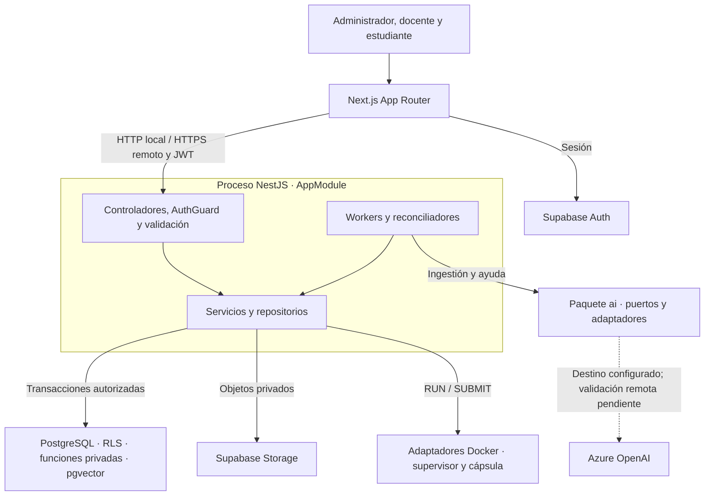
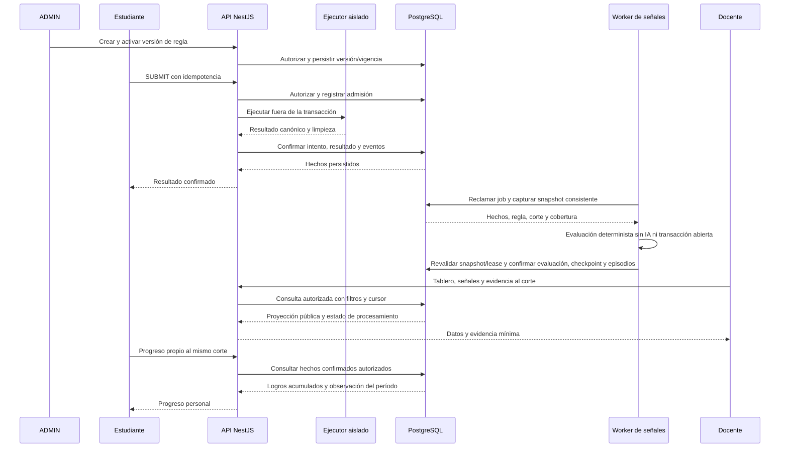

# Arquitectura de Alunza

**Ampliación IMP-03.07, 03/11/2026:** los puertos RUN/SUBMIT seleccionan Docker
local o Vercel en preproducción. Contexto admitido y recursos remotos se guardan
en PostgreSQL; los reconciliadores limpian según ese proveedor sin reejecutar
código. La [implementación y evidencia](../docs/work/IMP-03-sandbox.md) distingue
pruebas locales de validación remota pendiente; producción no se habilita.

**Ampliación IMP-06.04:** SignalReviewController/Service se integran en
AppModule y usan writeAs con identidad/sesión docentes para una operación SQL
autorizada. El kernel privado de captura se comparte con el wrapper protegido
del worker, sin convertir la petición docente en trabajo interno. UI de tablero
y detalle comparte confirmación y recuperación; NestJS conserva la única API.
Contrato y verificación en [el registro .04](../docs/work/IMP-06-signal-review.md).

Base verificada al **26/10/2026, America/Santiago**: arquitectura implementada hasta el cierre técnico local de IMP-05.08. Este documento describe el código existente y conserva los destinos aprobados; no acredita despliegue remoto ni aceptación CAPSTONE. La autoridad de producto permanece en [fuentes y decisiones](00-fuentes-y-decisiones.md) y la [ERS 1.3](<../Evidencias CAPSTONE/Fase 1/Evidencias de proyecto/Informe_ERS_Alunza.docx>).

**Cierre técnico local IMP-06.03:** el detalle docente reutiliza la API, persistencia y núcleos de IMP-03/04/05 mediante consultas de solo lectura. El [diccionario](../docs/work/IMP-06-student-detail-dictionary.md) concreta sus contratos; el [registro del incremento](../docs/work/IMP-06-student-detail.md) conserva las pruebas, las incidencias y la CI local aprobada del candidato. Este cierre no acredita despliegue remoto ni aceptación CAPSTONE y no completa IMP-06.

El [estado actual](../docs/estado-actual.md) reúne la navegación por capacidad. El [registro .08](../docs/work/IMP-05-acceptance.md) y su [matriz](../docs/work/IMP-05-acceptance-matrix.md) conservan las pruebas, el candidato y los límites del cierre; esta actualización documental no constituye otra corrida.

## Decisiones y distribución implementada

AD-ARQ-001 mantiene Next.js App Router en Vercel, NestJS en Azure Container Apps, Supabase Auth/PostgreSQL/Storage/RLS/pgvector, Vercel Sandbox productivo y Docker local. AD-IA-001 mantiene Azure OpenAI como proveedor inicial de generación y embeddings detrás de interfaces configurables. Los adaptadores existentes y su verificación local no sustituyen la validación de esos destinos.

La aplicación tiene una única API de dominio NestJS. [AppModule.register](../apps/api/src/app.module.ts) compone directamente los controladores, servicios, repositorios, adaptadores y workers. Las carpetas organizan áreas del monolito; no son módulos Nest independientes ni microservicios desplegados. Next.js presenta los flujos por rol, gestiona la sesión y consume contratos públicos; no implementa una segunda API de negocio.



El esquema muestra responsabilidades de ejecución, no un despliegue remoto acreditado. En TEST se seleccionan proveedores de IA explícitos; la búsqueda recupera únicamente fuentes autorizadas a través de los repositorios y funciones de datos. La información del modelo no calcula diagnósticos, progreso, señales ni decisiones de gobierno.

| Componente | Estado implementado y verificado localmente | Destino o validación pendiente |
| --- | --- | --- |
| Web y API | Next.js y NestJS arrancables mediante scripts y Compose; recorridos de roles en LAB TEST | Vercel y Azure Container Apps; operación remota de este candidato |
| Datos, identidad y archivos | Supabase local; migraciones, Auth, Storage y pruebas de aislamiento | Configuración y comprobación del ambiente remoto |
| Ejecución | La composición de API enlaza `ExecutionPort` y `SubmissionExecutionPort` con adaptadores Docker | Existe adaptador Vercel en `packages/runner`; su presencia no acredita el flujo productivo ni IMP-03.07 |
| IA | Puertos, adaptadores Azure, ingestión, ayuda y evaluación con proveedores TEST explícitos | Azure real, calibración/evaluación docente y medición de ayuda visible en navegador |
| Calidad y operación | Scripts, configuración GitHub Actions y CI ejecutada localmente para .08; ejecuciones remotas históricas de otros commits | CI Linux/remota del candidato .08, despliegue y aceptación humana |

La configuración de desarrollo observada en [.env.example](../.env.example) usa web `3200`, API `4200` y gateway Supabase `17421`. [Compose](../infra/compose.yaml) publica API `4200` hacia el puerto interno `4000` y web `3200` hacia `3000`; el valor predeterminado de `PORT` en [config.ts](../apps/api/src/config.ts) es `4000`. Son valores locales, no direcciones de producción. Los arneses aíslan LAB TEST de DEV y LAB-EVAL; no se deduce un ambiente remoto de estos puertos.

## Stack y workspace existentes

Las versiones siguientes se leen de [package.json](../package.json), [API](../apps/api/package.json), [web](../apps/web/package.json) y el lockfile. Son el corte implementado, no una recomendación de actualizar dependencias.

| Capa | Configuración actual |
| --- | --- |
| Workspace | npm workspaces `apps/*` y `packages/*`; un `package-lock.json`; Node.js `24.21.0` y npm `11.19.0` |
| Web | Next.js `16.3.4`, React `19.3.0`, TypeScript `5.9.3` y App Router |
| Interfaz | Tailwind CSS `4.3.3`, Radix UI `1.6.7`, componentes locales y Zod `4.6.1`; tablero tabular sin dependencia gráfica |
| API | NestJS `12.0.1`, Express `5.2.1`, TypeScript `5.9.3`; paquete CommonJS |
| Datos | `pg` `8.23.0`, Supabase JS `2.116.0`, CLI `2.101.0`; configuración local PostgreSQL major `17`, RLS y pgvector |
| Ejecución e IA | Paquetes propios `runner` y `ai`; adaptadores y contratos con pruebas específicas |
| Pruebas | Jest `30.5.1` y Cypress `16.0.0`; scripts de integración HTTP/SQL, rendimiento, actualización de esquema y CI |

El registro de [fundación](../docs/work/IMP-00-foundation.md) documenta PostgreSQL `17.6` y pgvector `0.8.0` observados en aquel corte. La versión de un servicio remoto debe verificarse en su ambiente. Recharts figuraba en la línea base de interfaz, pero no está instalado; la UI actual usa tablas. El editor existente usa un `textarea`, sin atribuirle una biblioteca de editor no incorporada.

```text
apps/web/                 Rutas App Router, componentes, sesión y transporte
apps/api/src/             Composición NestJS y áreas de dominio
packages/contracts/       DTO públicos, schemas y contratos HTTP
packages/ai/              Puertos/adaptadores, extracción, recuperación y ayuda
packages/runner/          Supervisor, protocolo, cápsula y adaptadores
supabase/migrations/      Modelo, funciones, roles, RLS e índices
supabase/tests/           Aserciones SQL y de aislamiento
fixtures/                 Datos ficticios y corpus de prueba
scripts/                  Entornos, integración, medición y operación local
tests/e2e/                Recorridos Cypress por incremento
infra/                    Compose, runner y preparación de despliegue
specs/                    Requisitos, decisiones y contratos consolidados
docs/work/                Registros y referencias a evidencia por candidato
```

No existe `packages/domain`. Los evaluadores puros de señales están en `apps/api/src/signals`; las proyecciones y consultas autorizadas de progreso/tablero se concretan en migraciones SQL y servicios API. No se introduce un paquete adicional por actualizar esta descripción.

## Áreas del backend y responsabilidades

| Carpeta real bajo `apps/api/src` | Responsabilidad implementada |
| --- | --- |
| `identity`, `governance` | Verificación JWT/sesión, perfiles y pertenencias, gobierno institucional e invitaciones durables |
| `academic` | Cursos, clases, docentes, matrícula e incorporación |
| `content`, `activities` | Conceptos y ejercicios versionados, gobierno administrativo del banco, pruebas, asignaciones y publicación/cierre |
| `practice` | RUN y SUBMIT, admisión, idempotencia, ejecución aislada, resultados persistidos y reconciliación |
| `materials` | Fuentes/versiones, objetos privados, ingestión y publicación de índices autorizados |
| `help` | Solicitudes posteriores al intento, contexto mínimo, generación/verificación, feedback persistido y ACK de presentación |
| `evaluation`, `evaluation-calibration` | Ledger y control de llamadas de IA, ejecución por etapas y calibración en ambientes habilitados |
| `progress` | Consulta del progreso propio y observaciones al corte; apertura elegible de actividad |
| `rules` | Consulta, creación y activación administrativa de versiones de reglas |
| `signals` | Evaluadores deterministas, snapshots, jobs/checkpoints, episodios e historia; revisión pública autorizada y auditada de IMP-06.04 |
| `dashboard` | Agregados docentes, alumnado paginado, evidencia mínima, señales y detalle integral autorizado del estudiante de la clase en IMP-06.03 |
| `database`, `http`, `health` | Contexto transaccional, errores/correlación, validación de infraestructura y salud |

Estos nombres describen el árbol real; no existen carpetas `Feedback`, `Audit` u `Operations` como módulos autónomos. La auditoría persistida y las capacidades operacionales se distribuyen entre los casos de uso y el esquema. La evidencia mínima de IMP-05 se amplía con la consulta integral RF-017 de IMP-06.03. IMP-06.04 añade la operación pública RF-019 mediante autorización propia; el helper de pruebas de revisión permanece privado.

## Datos y fronteras de confianza

1. **Navegador a API:** `AuthGuard` verifica el JWT y transmite actor/sesión. Cada operación comprueba permisos vigentes por rol, estado, organización y clase; IDs o metadatos del cliente no conceden acceso. ADMIN de gobierno no implica lectura pedagógica.
2. **API a PostgreSQL:** [DatabaseService](../apps/api/src/database/database.service.ts) usa el rol limitado `alunza_app`. Comprueba ausencia de superusuario, BYPASSRLS, herencias, membresías y propiedad del esquema/tablas `app`. `readAs` abre una transacción de solo lectura; `writeAs`, una de escritura. Actor, sesión y contexto de organización se inicializan con alcance transaccional, y las funciones de dominio validan el ámbito aplicable.
3. **Operaciones internas:** los workers usan la entrada interna sin reutilizar una sesión de navegador. Funciones acotadas, leases y permisos SQL delimitan sus acciones; esto no convierte el rol de aplicación en propietario o administrador general.
4. **API a ejecutor:** código estudiantil no confiable, separado de la API. El supervisor construye el resultado canónico; una cadena impresa por el alumno no constituye un resultado de prueba.
5. **API a IA:** código y documentos son contenido no confiable. El contexto se construye en servidor a partir del intento confirmado y las fuentes autorizadas. El modelo no recibe herramientas para mutar datos ni cambiar resultados deterministas.

El esquema `app` contiene entidades y proyecciones del dominio protegidas por permisos/RLS. `app_private` contiene funciones y evidencia interna cuya exposición se restringe por grants. Las funciones privilegiadas asignadas a `alunza_identity` usan un propietario `NOLOGIN`, sin BYPASSRLS, y un `search_path` acotado; cada migración define sus privilegios y políticas. No se debe inferir que toda función privada tiene el mismo grant ni que `SECURITY DEFINER` elimina la necesidad de autorización.

La API accede a SQL mediante `pg`; el navegador no usa PostgREST como CRUD de dominio. Las credenciales privilegiadas de Auth/Storage quedan en adaptadores de servidor, no en el acceso general de cada request. Los contratos públicos proyectan los campos autorizados: las pruebas ocultas, secretos y snapshots internos no se entregan al navegador ni al modelo. El código estudiantil conserva su acceso autorizado y puede integrar el contexto mínimo de ayuda del intento correspondiente. Véanse [datos](06-modelo-de-datos.md) y [seguridad](09-seguridad-y-privacidad.md).

## Secuencia de hechos, evaluación y lectura



La secuencia separa la persistencia de hechos, la evaluación asíncrona y las lecturas. El progreso procede de hechos confirmados y no necesita esperar una nueva evaluación de señales. La activación de reglas gobierna la evaluación; no reescribe resultados, intentos ni versiones anteriores.

**DEC-002:** el cierre bloquea nuevas admisiones SUBMIT. Una ejecución admitida antes puede confirmar después, asociada a su versión y hora de admisión; entregar o consultar resultados sigue exigiendo autorización vigente. La política está implementada y probada localmente en [IMP-03](../docs/work/IMP-03-submissions.md); el plan histórico anterior no representa su estado actual.

**DEC-003/007:** RUN/SUBMIT usan QuickJS/WASM dentro de la cápsula y un supervisor de confianza. Se conservan las dos capas: Sandbox de 1 vCPU/2 GB y proceso estudiantil de 128 MiB, 3000 ms acumulados y 64 KiB de salida combinada. El [contrato de ejecución](13-ejecucion-controlada.md) y las pruebas por adaptador delimitan lo demostrado; Docker no acredita aislamiento de Vercel Sandbox productivo.

En las consultas .07/.08, `asOf` fija el corte de los hechos y `from` delimita la observación de actividad, sin convertir el logro acumulado en logro del período. La matrícula y los permisos se consultan vigentes: un corte anterior no reconstruye una matrícula histórica. La UI presenta fechas en la zona de la organización y conserva instantes exactos en los contratos. Los cursores quedan ligados al ámbito, filtros y corte.

Los estados de episodio `ACTIVE`/`REVIEWED` se distinguen de `NOT_EVALUATED`, `PENDING`, `FAILED` y `UP_TO_DATE` del procesamiento. Un episodio ACTIVE histórico puede seguir visible; cero señales no significa por sí solo evaluación exitosa. La reconstrucción opera sobre proyecciones derivadas y conserva hechos, reglas e historia; hechos confirmados tardíamente pueden cambiar legítimamente una lectura posterior al mismo corte. Véanse [semántica](14-progreso-y-senales.md), [episodios](../docs/work/IMP-05-episodes.md) y [tablero](../docs/work/IMP-05-dashboard.md).

## Ayuda y trabajos durables

La ayuda es una solicitud separada sobre un intento ya confirmado. [HelpWorker](../apps/api/src/help/help.worker.ts) recupera contexto autorizado, invoca proveedores fuera de transacciones y persiste una salida validada o degradación explícita. Un ACK idempotente registra presentación elegible; polling o mera solicitud no equivalen a ayuda entregada. La ingestión autorizada de materiales genera embeddings sin requerir un intento estudiantil. Los registros de [materiales](../docs/work/IMP-04-materials.md), [ayuda](../docs/work/IMP-04-help.md) y [evaluación](../docs/work/IMP-04-evaluation.md) detallan sus contratos.

Invitaciones, materiales, ayuda y señales tienen registros de trabajo persistidos, reclamación con lease y recuperación específica. Sus workers se registran en el mismo proceso NestJS y sus flags de habilitación tienen valor predeterminado `false`; su presencia en `AppModule` no significa que estén procesando. RUN/SUBMIT cuentan además con reconciliadores propios. No existe una cola externa desplegada ni basta una promesa en memoria para acreditar durabilidad.

La finalización comprueba lease, versión y permisos aplicables; la idempotencia evita repetir hechos por transporte. El ledger de IA distingue llamadas autorizadas, despachadas e inciertas para no repetir silenciosamente un gasto remoto cuyo resultado se desconoce. Las consultas de progreso/tablero usan funciones SQL autorizadas e índices; las optimizaciones aditivas .08 no incorporan una caché de resultados pedagógicos ni de permisos.

## Salud y alcance de la verificación

`GET /health/live` informa liveness del proceso. `GET /health/ready` comprueba el rol SQL limitado y la presencia de tablas/funciones requeridas, incluidas las consultas .07, las cuatro lecturas administrativas IMP-06.01, la función de validación del propietario IMP-06.02 y las ocho entradas de detalle docente IMP-06.03. Un resultado ready no demuestra disponibilidad de Azure, avance de todos los workers ni un despliegue remoto. Los ensayos de actualización distinguen preparación sobre el esquema anterior de readiness del esquema candidato; el de .02 comprueba también la instalación y habilitación del trigger de propiedad.

La CI local de producto de [IMP-05.08](../docs/work/IMP-05-acceptance.md) aprobó sus 17 etapas. El registro conserva los conteos y las muestras de pruebas unitarias, HTTP, SQL, E2E y los tres gates SUBMIT. La verificación transversal cubre reglas, motor, tablero y progreso, con 60 estudiantes y perfiles de las tres pantallas. La carga UI de cuatro corresponde a un Chrome más tres lectores HTTP; no equivale a cuatro navegadores ni a medición de ayuda renderizada.

La ampliación [IMP-06.01](../docs/work/IMP-06-bank-read.md), cerrada localmente
el 27/10/2026 con CI 17/17, añade cuatro lecturas de gobierno en el módulo
`content` de NestJS y la pantalla administrativa del banco. Sus proyecciones
SQL reautorizan ADMIN y entregan metadatos, versiones y usos; mantienen la
separación de la evidencia pedagógica y la autoría. Reutiliza la topología y
las entidades existentes. Ese corte no incluía las mutaciones administrativas
posteriores de .02.

La ampliación [IMP-06.02](../docs/work/IMP-06-bank-governance.md) implementa
propiedad/visibilidad, versionado administrativo y archivo desde esa pantalla.
Reutiliza servicios de `content`, bloqueo de organización, ETag, idempotencia
y auditoría transaccional. La migración aditiva valida el propietario nuevo y
permite a ADMIN insertar una definición completa, sin ampliar autoría docente
ni acceso a evidencia estudiantil. Sus focos locales verificaron 14 pruebas
HTTP, 1126 aserciones SQL en 18 archivos, cinco recorridos Cypress y la
actualización .01→.02 con datos y auditoría previa conservados. La evidencia
integrada y sus límites se mantienen en el registro del incremento.

La ampliación IMP-06.03 incorpora [StudentDetailController](../apps/api/src/dashboard/student-detail.controller.ts) y [StudentDetailService](../apps/api/src/dashboard/student-detail.service.ts), con GET bajo `/classes/:classId/students/:studentId`. Reautoriza al docente asignado y al estudiante `CURRENT_ACTIVE` antes de consultar progreso, intentos, ayuda o señales. Conserva actor y sesión docentes; no invoca rutas del alumno ni transforma lecturas en eventos pedagógicos. Los filtros y cursores incluyen el estudiante, y el procesamiento de señales se calcula dentro de ese ámbito.

La ayuda docente exige un evento persistido `HINT_DELIVERED` o `FEEDBACK_VIEWED` hasta `asOf`; ayuda preparada o presentada sin ACK no aparece ni se abre por ID. El contenido revocado devuelve `available=false, help=null`. Las citas se autorizan antes y después de descargar desde Storage, conservando el corte original. Las consultas no generan ayuda, recalculan señales ni modifican intentos, progreso, acuses o auditoría; muestran solo pruebas visibles y el resumen público de verificaciones ocultas.

Los registros de los cortes previos conservan sus resultados; el [cierre técnico local IMP-06.03](../docs/work/IMP-06-student-detail.md) documenta su propia verificación y las incidencias preservadas. La CI Linux/remota de los candidatos IMP-05.08 e IMP-06.03 sigue pendiente; las [ejecuciones remotas del 02/10](../docs/work/2026-10-02-git-and-ci.md) corresponden a sus commits históricos. Azure real, Vercel Sandbox productivo, despliegues y aceptación CAPSTONE conservan verificación independiente. RF-019 público está implementado en [IMP-06.04](../docs/work/IMP-06-signal-review.md), con focos locales aprobados y cierre integral pendiente; IMP-06.05 y .06 están implementados y verificados localmente; .07 está verificado funcionalmente, con aceptación integral bloqueada por .04 y CI pendiente. La auditoría IMP-07.01 conserva la identidad de esas evidencias y distingue las brechas de validación. Las metas de tiempo y los límites por entorno se consultan en [calidad](10-calidad-y-pruebas.md) y en los registros, sin atribuirlos a la sola elección de arquitectura.
